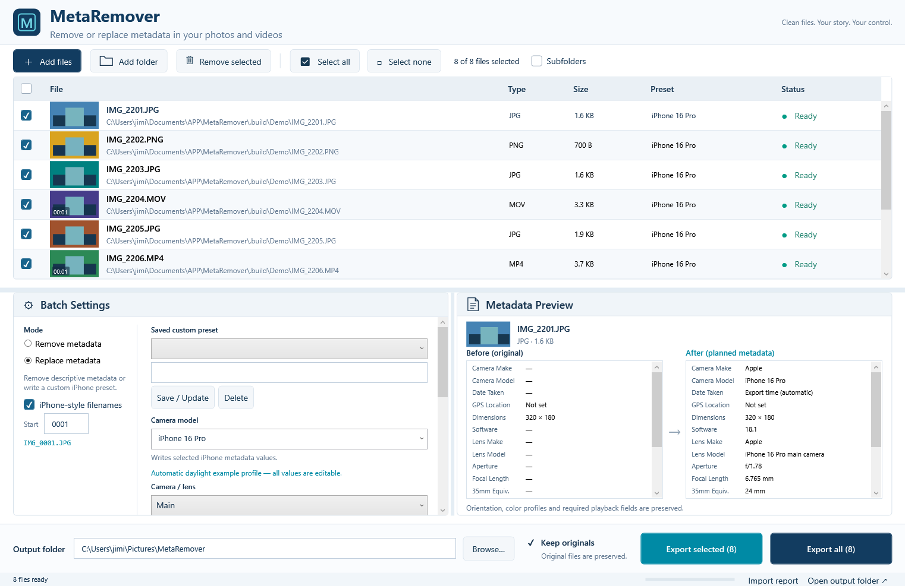

<div align="center">

# MetaRemover

### Your media. Your metadata. Your control.

**A Windows desktop app for bulk photo and video metadata cleanup, editable iPhone presets, and safe export.**


**[Download Installer](https://github.com/AbulH88/MetaRemover/releases/latest/download/MetaRemover-Setup-x64.exe)** · **[Download Portable ZIP](https://github.com/AbulH88/MetaRemover/releases/latest/download/MetaRemover-Windows-x64.zip)** · **[All Releases](https://github.com/AbulH88/MetaRemover/releases)**

</div>



*Actual app interface with generated demonstration files.*

## What is MetaRemover?

Import a batch of images and videos, inspect their metadata, and export new copies with descriptive tags removed or replaced. Processing happens locally on your computer. Originals remain unchanged, images are not recompressed, and video is processed without re-encoding.

## Resources & downloads

| Resource | Download / open |
| --- | --- |
| **Windows installer — recommended** | [MetaRemover-Setup-x64.exe](https://github.com/AbulH88/MetaRemover/releases/latest/download/MetaRemover-Setup-x64.exe) |
| Portable app | [MetaRemover-Windows-x64.zip](https://github.com/AbulH88/MetaRemover/releases/latest/download/MetaRemover-Windows-x64.zip) |
| SHA-256 checksums | [SHA256SUMS.txt](https://github.com/AbulH88/MetaRemover/releases/latest/download/SHA256SUMS.txt) |
| Release notes / older versions | [GitHub Releases](https://github.com/AbulH88/MetaRemover/releases) |
| Source code | [Browse source](src) |
| Support / bug reports | [Open an issue](https://github.com/AbulH88/MetaRemover/issues) |

**Requires Windows 10/11, 64-bit x64.** Downloads include the .NET runtime, ExifTool, FFmpeg, and FFprobe; recipients do not install these separately.

**Install:** run the installer. It installs for your current user with a Start menu shortcut and optional desktop shortcut.

**Portable:** extract the entire ZIP and open `MetaRemover.exe`. Keep its runtime, tools, and DLLs alongside it. Share the full ZIP or single installer.

## Features

- **Bulk import/export:** multiple files, folders, drag-and-drop, optional subfolders, and duplicate filtering.
- **Remove or replace:** clear supported descriptive metadata or apply editable iPhone metadata.
- **One-click profiles:** select a built-in iPhone model and camera to autofill a daylight example profile.
- **Saved presets:** name, save, update, delete, and reuse custom settings across restarts.
- **Before/after preview:** inspect source tags, planned changes, and verified output.
- **Resizable workspace:** drag panel dividers to expand settings and preview.
- **iPhone-style naming:** `IMG_0001.JPG`, configurable counters, no overwrites, and rollover after 9999.
- **Safe processing:** output copies, cancellation, progress, per-file results, and media-preservation checks.

## Supported media

| Format | Metadata | Preservation |
| --- | --- | --- |
| JPG/JPEG, PNG, WebP | EXIF camera, lens, exposure, date, software, optional GPS | No recompression; orientation and ICC profiles retained |
| MP4, MOV | Make/model, software, dates, optional GPS, supported VideoKeys lens fields | Audio/video stream copy; playback properties verified |

**HEIC/HEIF and RAW are not supported in this version.** Files keep their actual extension; renaming does not convert formats. Auxiliary, subtitle, or timed-data tracks require explicit opt-in to removal under **More options**.

## Quick start

1. Click **Add files** / **Add folder**, or drag media into the window.
2. Choose **Remove metadata** or **Replace metadata**.
3. For replacement, select a phone such as **iPhone 16** and an available camera. The fields autofill; edit any values you want.
4. Choose your output folder and filename options.
5. Click **Export selected** for checked files or **Export all** for the full queue.

Select a row to inspect its metadata. **Failed** / **Review** rows include their reasons in the preview or tooltip. Cancel keeps completed exports and removes unfinished staging files.

### Automatic profiles and custom presets

Built-in profiles fill the lens, aperture, physical/equivalent focal lengths, ISO **100**, shutter **1/250 s**, exposure **0 EV**, flash **off**, automatic white balance, and an example iOS/software version. These are **editable example values**, not recovered capture measurements or proof of iPhone capture. Phone/camera selection reapplies the profile; **Autofill all fields** restores it after edits.

Enter a name under **Saved custom preset**, then click **Save / Update**. Selecting it later restores your exact values. Presets live in `%LOCALAPPDATA%\MetaRemover\presets.json` and survive upgrades. The output folder stays your current choice. To refresh an older preset, click Autofill all fields and save again.

### Dates, GPS, and filenames

- **Keep original** preserves capture dates. **Use export time if original date is missing** supplies one timestamp captured at batch start. Built-in profiles enable it; older presets keep their previous policy.
- Uncheck Keep original to enter a fixed date and UTC offset. Presets store the policy rather than a stale export timestamp.
- GPS stays off unless explicitly set. Blank optional fields are omitted.
- Change the starting counter or disable iPhone-style filenames to keep original basenames. Existing files are never overwritten; after 9999 export continues in a numbered subfolder.

## Build from source

Install a [.NET 10 SDK](https://dotnet.microsoft.com/download/dotnet/10.0) on Windows. Tool binaries are excluded from Git; the helper downloads the matching tools, license notices, and source materials from the portable release and verifies its SHA-256 checksum.

```powershell
git clone https://github.com/AbulH88/MetaRemover.git
cd MetaRemover
powershell -ExecutionPolicy Bypass -File scripts/bootstrap-tools.ps1
dotnet test tests/MetaRemover.Tests
dotnet build src/MetaRemover.App
powershell -ExecutionPolicy Bypass -File scripts/package.ps1
```

Output goes to `dist`. Install [Inno Setup](https://jrsoftware.org/isdl.php) to also build the installer:

```powershell
powershell -ExecutionPolicy Bypass -File scripts/installer.ps1 -Compiler 'C:\Program Files\Inno Setup 7\ISCC.exe'
```

Alternatively, provide `tools/exiftool` (executable plus `exiftool_files`) and `tools/ffmpeg` (LGPL shared FFmpeg/FFprobe and DLLs) yourself. Keep required source archives and notices. `package.ps1` prefers `.build/dotnet/dotnet.exe` when present, otherwise the SDK on PATH.

## Verification

Version **1.3.0** passed **61 automated tests**, native WPF autofill/preset diagnostics, and installed-app checks across all five supported formats. See [verification details](docs/verification.md) and [camera references](docs/camera-catalog-sources.md).

Diagnostic commands:

```text
MetaRemover.exe --smoke-test absolute-working-directory
MetaRemover.exe --camera-ui-test absolute-result-file.txt
MetaRemover.exe --screenshot absolute-output.png
MetaRemover.exe --demo-folder absolute-folder --screenshot absolute-output.png
```

## Limits and licensing

Required image/container/codec fields remain. Removal of every vendor-specific identifier inside media streams is not guaranteed. Unusual codecs and vendor HDR metadata are not exhaustively validated; preservation failures are rejected rather than silently transcoded.

iPhone presets do not add authentic Apple MakerNotes, establish Apple capture provenance, or create Live Photos. MetaRemover is independent and not affiliated with Apple.

App source is **MIT licensed**. Bundled tools retain their licenses, notices, and source materials. See [LICENSE](LICENSE), [third-party notices](THIRD-PARTY-NOTICES.md), and [release history](CHANGELOG.md).
